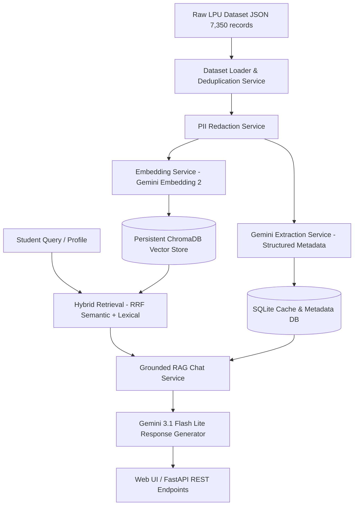

# LPU SmartNotice — AI-Powered Personalized University Announcement Assistant

[](https://www.python.org/)
[](https://fastapi.tiangolo.com/)
[](https://ai.google.dev/)
[](https://www.trychroma.com/)

**LPU SmartNotice** is an AI-powered personalized university announcement retrieval and recommendation system built for Lovely Professional University (LPU). It addresses information overload by filtering, ranking, and answering student questions grounded strictly in official university announcement evidence.

---

## 🌟 Key Features

1. **Dataset Validation & Deduplication:** Processes 7,350 historical LPU announcement records, generating deterministic stable IDs and distinguishing exact duplicates from legitimate notice revisions.
2. **AI Structured Information Extraction:** Uses Gemini API with Pydantic structured schemas to extract categories, target years, departments, deadlines, room numbers, and urgency levels.
3. **Attachment-Aware Evidence Policy:** Explicitly tracks attachment presence (`attachment_present=True`) vs attachment content availability (`attachment_content_available=False`), preventing hallucinated claims from missing PDF files.
4. **Persistent Hybrid RAG Pipeline:** Combines 768-dimensional Gemini embeddings (`gemini-embedding-2`) stored in ChromaDB with lexical scoring (Reciprocal Rank Fusion) for exact room, date, and reference number retrieval.
5. **Grounded RAG Chatbot:** Answers natural language questions with strict citation enforcement and explicit warning when evidence or referenced attachments are incomplete.
6. **Transparent Personalized Feed:** Ranks announcements for synthetic student profiles using year matching, program alignment, interest similarity, urgency, and global safety overrides.
7. **Room & Timetable Conflict Analysis:** Normalizes room representations (e.g. `34-105` vs `Block 34, Room 105`) and compares them against student schedules to flag affected classes.
8. **Interactive Web Interface:** A modern dark-mode web application featuring dashboard metrics, announcement search, personalized feed, RAG chatbot, timetable impact checker, and user feedback collection.

---

## 🏗 System Architecture



---

## 🛠 Quick Start Guide

### Prerequisites
- Windows 10/11 with Python 3.10+
- VS Code (recommended)
- Gemini API Key ([Get a key from Google AI Studio](https://aistudio.google.com/))

### 1. Environment Setup
Clone or navigate to the repository:
```powershell
# Navigate to the repository root
cd path\to\LPU-SmartNotice
```

Create and activate a virtual environment:
```powershell
python -m venv .venv
.venv\Scripts\Activate.ps1
```

Install dependencies:
```powershell
pip install -r requirements.txt
pip install -r requirements-dev.txt
```

### 2. Configure Environment Variables
Copy `.env.example` to `.env` and insert your Gemini API Key:
```env
GEMINI_API_KEY=your_actual_gemini_api_key
GEMINI_GENERATION_MODEL=gemini-3.1-flash-lite
GEMINI_EMBEDDING_MODEL=gemini-embedding-2
DATASET_PATH=data/all_announcements_with_attachment_flag.json
SQLITE_PATH=storage/smartnotice.db
CHROMA_PATH=storage/chroma_db
EMBEDDING_DIMENSION=768
INITIAL_INDEX_LIMIT=25
```

### 3. Step-by-Step Safe Execution Workflow

> [!IMPORTANT]
> To prevent unnecessary paid API calls, run dataset validation and dry-runs first before full indexing.

#### Step 3.1: Validate Dataset (No API calls)
```powershell
python -m app.scripts.validate_dataset
```

#### Step 3.2: Run Dry-Run Extraction Sample (No API calls)
```powershell
python -m app.scripts.analyze_sample --limit 5 --dry-run
```

#### Step 3.3: Analyze Sample with Gemini API
```powershell
python -m app.scripts.analyze_sample --limit 5
```

#### Step 3.4: Build Vector Index (Safe Limit: 25 documents)
```powershell
python -m app.scripts.build_index --limit 25
```

#### Step 3.5: Run System Evaluation Suite
```powershell
python -m app.scripts.evaluate_system
```

### 4. Start the Application Server
```powershell
python -m uvicorn app.main:app --reload --port 8000
```

Open your browser:
- **Web Interface:** [http://127.0.0.1:8000](http://127.0.0.1:8000)
- **API Swagger Documentation:** [http://127.0.0.1:8000/docs](http://127.0.0.1:8000/docs)

---

## 🏛️ LPU UMS Announcement Integration & Sync

LPU SmartNotice includes a modular connector and incremental synchronization pipeline for Lovely Professional University Management System (UMS).

### Connector Modes
1. **Mock Mode (`UMS_CONNECTOR_MODE=mock`, default):**
   - Safe, non-intrusive mode providing simulated, highly realistic LPU announcements.
   - Requires no university credentials or network calls. Ideal for local development, CI/CD, and demonstrations.
2. **Live Mode (`UMS_CONNECTOR_MODE=live`):**
   - Connects to official portal endpoint (`StudentDashboard.aspx/AnnouncementDetails`) using an authenticated user session cookie (`UMS_SESSION_COOKIE`).
   - If credentials are missing or expired, reports `AUTH_REQUIRED` or `AUTH_EXPIRED` without making unauthorized requests.

### Configuration (`.env`)
```env
UMS_BASE_URL=https://ums.lpu.in/lpuums/
UMS_ANNOUNCEMENTS_ENDPOINT=https://ums.lpu.in/lpuums/StudentDashboard.aspx/AnnouncementDetails
UMS_CONNECTOR_MODE=mock
UMS_SESSION_COOKIE=ASP.NET_SessionId=your_authenticated_session_cookie_here
SYNC_ADMIN_KEY=your_secure_admin_key_here
AUTO_EMBED_NEW_NOTICES=true
```

### Triggering & Inspecting Sync
- **Via Web UI:** Click the **"⚡ Sync UMS Notices"** button on the Personalized Feed or Dashboard tab.
- **Via REST API:**
  ```powershell
  # Check connector configuration & reachability
  curl http://127.0.0.1:8000/api/v1/ums/status

  # Trigger incremental synchronization (protected by X-Sync-Token)
  curl -X POST "http://127.0.0.1:8000/api/v1/ums/sync?limit=25" -H "X-Sync-Token: your_secure_admin_key_here"

  # View synchronization audit history
  curl http://127.0.0.1:8000/api/v1/ums/sync/history
  ```

### Synchronization Pipeline & Invariant Rules
- **Non-Destructive:** The historical 7,350-record dataset is 100% immutable and preserved.
- **Deduplication:** Uses content SHA-256 hashes and reference numbers to skip identical notices.
- **Revision Tracking:** When an announcement is edited (e.g. room shifted or deadline extended), the existing record is updated and its `revision_count` is incremented.
- **AI Pipeline Integration:** New/revised notices undergo Gemini structured metadata extraction, are cached in SQLite, and upserted into ChromaDB for instant semantic search and personalized feed ranking.
- **Attachment Awareness:** Preserves `attachment_present` and `attachment_names`. Never claims a room is exempt or a qualification is met if attachment documents remain unparsed.
- **Concurreny Protection:** Enforces thread-safe locking so duplicate simultaneous syncs cannot race or leave SQLite / ChromaDB in an inconsistent state.

---

## 🧪 Automated Testing
Run the complete 51-test suite using pytest:
```powershell
# In PowerShell:
.venv_new\Scripts\python.exe -m pytest tests/ -v
# Or if your venv is activated:
pytest -v
```

---

## 📚 Comprehensive Documentation Directory

Detailed technical documentation is available under `docs/`:

| Topic | Document Link | Description |
| :--- | :--- | :--- |
| **Audit & Baseline** | [project_audit.md](docs/project_audit.md) | Comprehensive Phase 0–1 system audit, architecture & feature inventory |
| **Bug Tracker** | [bug_tracker.md](docs/bug_tracker.md) | Bugs catalogue (BUG-001 through BUG-010) with severity, root causes & fixes |
| **Repair Log** | [repair_log.md](docs/repair_log.md) | Stage-by-stage engineering repairs across all 10 phases |
| **Test Report** | [test_report.md](docs/test_report.md) | Test suite verification report (51/51 tests passing, 100% success rate) |
| **Overview** | [PROJECT_OVERVIEW.md](docs/PROJECT_OVERVIEW.md) | Problem statement, research objectives & scope |
| **Architecture** | [SYSTEM_ARCHITECTURE.md](docs/SYSTEM_ARCHITECTURE.md) | Component diagrams, data flow & service interactions |
| **Data Dictionary** | [DATA_DICTIONARY.md](docs/DATA_DICTIONARY.md) | Complete reference of all data schemas & fields |
| **Data Quality** | [DATA_QUALITY_AND_PREPROCESSING.md](docs/DATA_QUALITY_AND_PREPROCESSING.md) | Deduplication, normalization & ID generation |
| **AI Extraction** | [AI_EXTRACTION_PIPELINE.md](docs/AI_EXTRACTION_PIPELINE.md) | Gemini structured output, caching & prompts |
| **RAG Pipeline** | [RAG_PIPELINE.md](docs/RAG_PIPELINE.md) | Embeddings, ChromaDB, RRF hybrid search & grounding |
| **Attachments** | [ATTACHMENT_AND_EVIDENCE_POLICY.md](docs/ATTACHMENT_AND_EVIDENCE_POLICY.md) | Attachment awareness & evidence completeness |
| **Personalization** | [PERSONALIZATION_AND_RANKING.md](docs/PERSONALIZATION_AND_RANKING.md) | Ranking formulas, interest scoring & overrides |
| **Timetable** | [ROOM_AND_TIMETABLE_IMPACT.md](docs/ROOM_AND_TIMETABLE_IMPACT.md) | Room normalization & schedule conflict checking |
| **Database** | [DATABASE_DESIGN.md](docs/DATABASE_DESIGN.md) | SQLite schema, indexes & ChromaDB metadata |
| **API Reference** | [API_REFERENCE.md](docs/API_REFERENCE.md) | Complete endpoint schemas & curl examples |
| **Security** | [SECURITY_AND_PRIVACY.md](docs/SECURITY_AND_PRIVACY.md) | PII redaction, key safety & local privacy |
| **Troubleshooting** | [SETUP_AND_TROUBLESHOOTING.md](docs/SETUP_AND_TROUBLESHOOTING.md) | Common errors & Windows environment fixes |
| **Testing** | [TESTING_AND_EVALUATION.md](docs/TESTING_AND_EVALUATION.md) | Unit tests, evaluation suite & metrics |

---

## 🔒 Security & Privacy Notes
- No API keys are committed to Git (`.gitignore` protects `.env`).
- PII redaction is applied locally before sending text to external LLM endpoints.
- Raw historical dataset remains stored locally and immutable.
