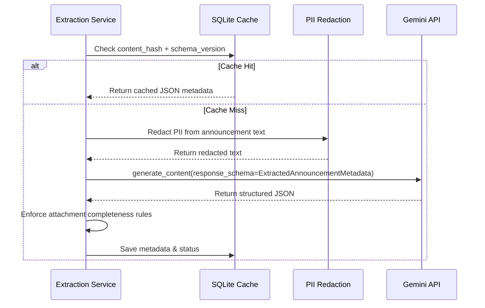

# AI Information Extraction Pipeline — LPU SmartNotice

## 1. Structured Extraction Overview
LPU SmartNotice uses Google's Gemini API (`gemini-3.1-flash-lite` or configured model) with strict Pydantic schema validation (`ExtractedAnnouncementMetadata`) to transform unstructured announcement text into validated structured facts.

## 2. Pydantic Schema Enforcement
Extraction uses Gemini native structured output (`response_mime_type="application/json"`). Fields include:
- `category`: Constrained enum set (`ACADEMIC`, `PLACEMENT`, `EXAMINATION`, `EVENT`, `ADMINISTRATIVE`, `HOSTEL`, `GENERAL`).
- `action_type`: Constrained enum set (`REGISTRATION`, `SUBMIT_DOCUMENT`, `ATTEND_EVENT`, `NO_CLASS`, `NONE`).
- `urgency`: `CRITICAL`, `HIGH`, `MEDIUM`, `LOW`.
- `decision_completeness`: `COMPLETE`, `PARTIAL`, `ATTACHMENT_MISSING`, `UNKNOWN`.

## 3. Caching & Cost Protection
- **Content Hash Caching:** Extractions are cached in SQLite `extracted_metadata` keyed by SHA-256 content hash and schema version (`v1.0`).
- **Low Confidence Routing:** Announcements receiving a confidence score `< 0.6` are assigned status `REVIEW` for audit.
- **Fallback Heuristics:** If API key is missing or network fails, a rule-based heuristic extraction fallback runs seamlessly.

---
*Return to [Root README](../README.md)*
