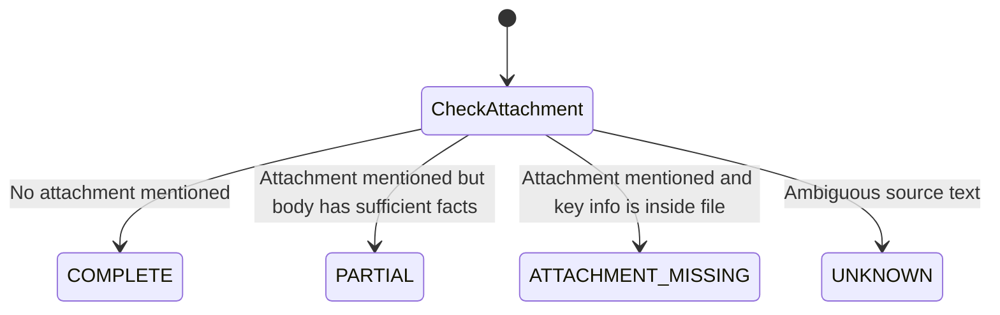

# Attachment & Evidence Policy — LPU SmartNotice

## 1. The Core Problem
Many university announcements reference attached documents (e.g., "See attached seating plan PDF", "Refer to attached guidelines spreadsheet"). However, raw dataset records contain only notice body text and attachment filenames—the actual PDF/XLS file contents are not downloaded.

Equating `attachment_present=true` with complete evidence leads to AI hallucinations.

## 2. Evidence Completeness Model
LPU SmartNotice explicitly distinguishes four states of evidence completeness:

| Enum State | Description | Chatbot Behavior |
| :--- | :--- | :--- |
| `COMPLETE` | Notice text contains all required facts. | Provides definitive grounded answer. |
| `PARTIAL` | General guidelines present in body, but sub-details attached. | Answers general rules, warns that attached document is unparsed. |
| `ATTACHMENT_MISSING` | Crucial decision info (e.g. roll number seating) is inside attached file. | Explicitly states: *"Attachment referenced but contents unavailable."* |
| `UNKNOWN` | Unclear or incomplete notice content. | Communicates uncertainty; requests verification from university office. |

## 3. Mandatory Rules
- **Rule 1:** `attachment_present=True` does NOT imply `attachment_content_available=True`.
- **Rule 2:** `attachment_content_available` is set to `False` for all current historical records.
- **Rule 3:** Chat responses MUST display a yellow attachment warning banner whenever a cited source has unparsed attachments.

---
*Return to [Root README](../README.md)*
