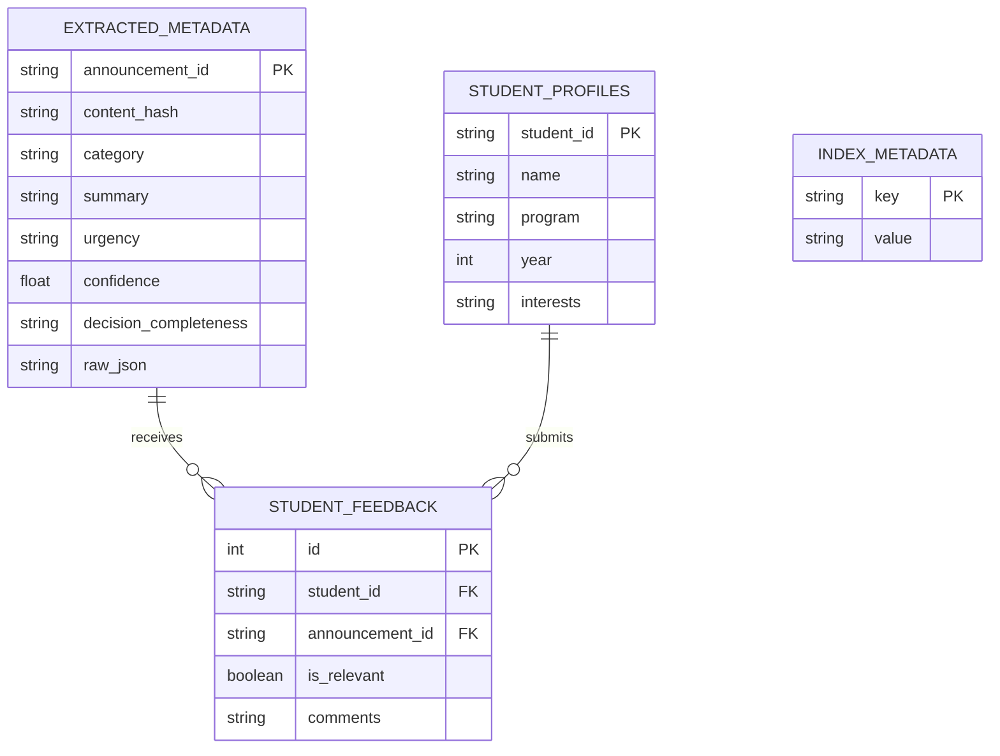

# Database Design — LPU SmartNotice

## 1. Overview
LPU SmartNotice uses a dual-database architecture:
1. **SQLite (`storage/smartnotice.db`):** Relational database for AI extraction caching, student profiles, user feedback, and indexing run metadata.
2. **ChromaDB (`storage/chroma_db`):** Vector database for 768-dimensional document embeddings and metadata filters.

## 2. Table Definitions

### `extracted_metadata`
Stores structured metadata extracted by Gemini to prevent repeating paid API calls.
- `announcement_id` TEXT PRIMARY KEY
- `content_hash` TEXT INDEXED
- `category` TEXT, `summary` TEXT, `urgency` TEXT
- `confidence` REAL, `decision_completeness` TEXT
- `raw_json` TEXT (Full JSON model dump)

### `student_profiles`
Pre-populated synthetic demo profiles for feed personalization.
- `student_id` TEXT PRIMARY KEY
- `name` TEXT, `program` TEXT, `year` INTEGER, `interests` TEXT

### `student_feedback`
Stores user feedback on recommendations to support future supervised ML training.
- `id` INTEGER PRIMARY KEY AUTOINCREMENT
- `student_id` TEXT, `announcement_id` TEXT, `is_relevant` BOOLEAN

---
*Return to [Root README](../README.md)*
