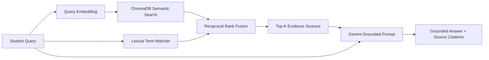

# Grounded RAG Pipeline — LPU SmartNotice

## 1. Overview
The Grounded Retrieval-Augmented Generation (RAG) pipeline enables students to ask natural language questions about LPU announcements. The assistant retrieves verifiable announcement evidence before generating an answer.

## 2. Embedding Model & Vector Index
- **Embedding Model:** `gemini-embedding-2` via `google-genai` SDK.
- **Dimensionality:** Configured at 768 dimensions (`output_dimensionality=768`).
- **Vector Database:** Local persistent ChromaDB store (`storage/chroma_db`).
- **Incremental Indexing:** Document IDs and content hashes prevent re-embedding unchanged documents.

## 3. Hybrid Search & Reciprocal Rank Fusion (RRF)
Vector search alone may struggle with exact alphanumeric strings like reference numbers (`LPU/EXAM/2026/101`) or specific room numbers (`34-105`). LPU SmartNotice uses hybrid retrieval:
1. **Semantic Score:** Cosine similarity from ChromaDB vector search.
2. **Lexical Score:** Exact phrase and token frequency matching for course codes, dates, and room numbers.
3. **RRF Formula:**
   $$RRF\_Score(d) = \sum_{m \in \{semantic, lexical\}} \frac{1}{k + rank_m(d)}$$
   where $k = 60$. Candidates are ranked by unified RRF score.

## 4. Citation Enforcement & Hallucination Prevention
- Gemini is explicitly instructed to cite Source IDs (e.g. `[Source ID: ANN-...]`) for every LPU statement.
- If retrieved evidence is insufficient, the system returns: `"Based on available announcements, I do not have enough information to answer."`

---
*Return to [Root README](../README.md)*
