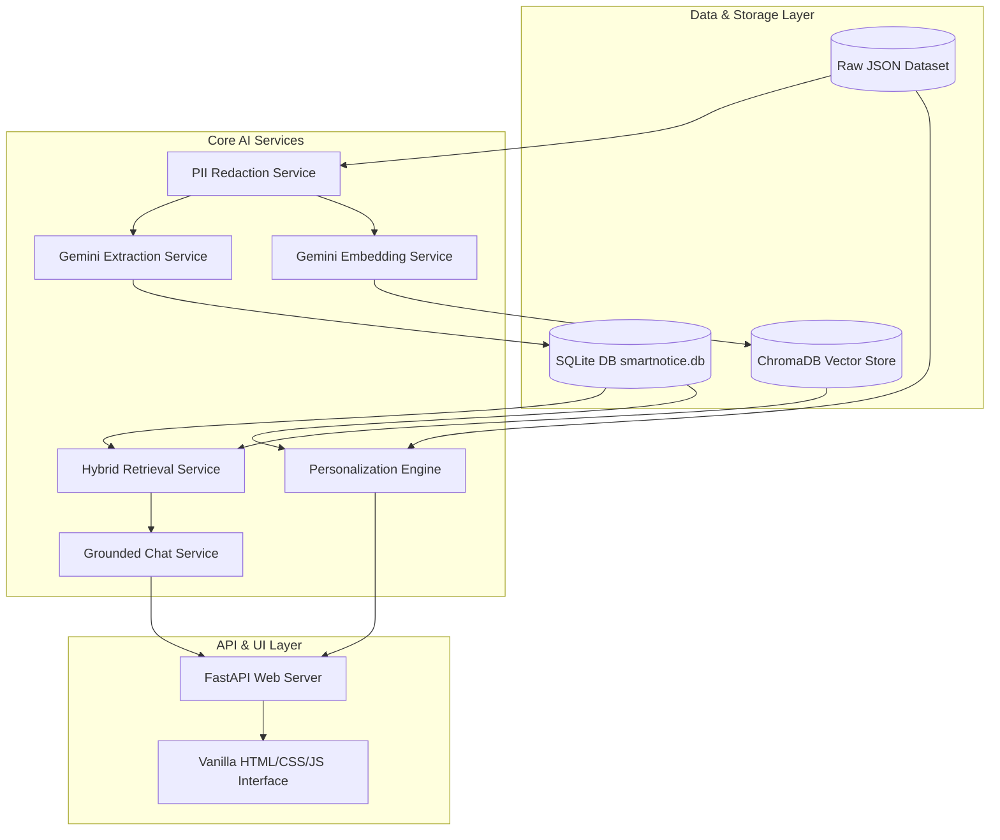

# System Architecture — LPU SmartNotice

## 1. High-Level Architecture
LPU SmartNotice follows a decoupled, modular architecture consisting of a data ingestion layer, AI extraction layer, persistent vector store, hybrid retrieval service, personalization engine, grounded RAG chatbot, and a FastAPI backend with a lightweight web frontend.

## 2. Component Responsibilities
- **DatasetService (`app/services/dataset_service.py`):** Loads raw JSON, validates schemas, calculates quality metrics, and generates deterministic stable IDs.
- **DeduplicationService (`app/services/deduplication_service.py`):** Identifies exact duplicates using SHA-256 content hashes while preserving distinct notice revisions.
- **PIIRedactionService (`app/services/pii_redaction_service.py`):** Masks phone numbers, student registration IDs, and personal emails before LLM transmission.
- **ExtractionService (`app/services/extraction_service.py`):** Calls Gemini API using Pydantic structured schemas and caches results in SQLite.
- **VectorStoreService (`app/services/vector_store_service.py`):** Manages persistent 768-dimensional embeddings in ChromaDB.
- **RetrievalService (`app/services/retrieval_service.py`):** Executes Reciprocal Rank Fusion (RRF) combining vector search with exact lexical matching.
- **PersonalizationService (`app/services/personalization_service.py`):** Computes student personal priority scores based on academic profile alignment.
- **RoomImpactService (`app/services/room_impact_service.py`):** Normalizes room numbers/ranges and evaluates timetable collision.
- **ChatService (`app/services/chat_service.py`):** Enforces grounded answer generation with citation references.

---
*Return to [Root README](../README.md)*
